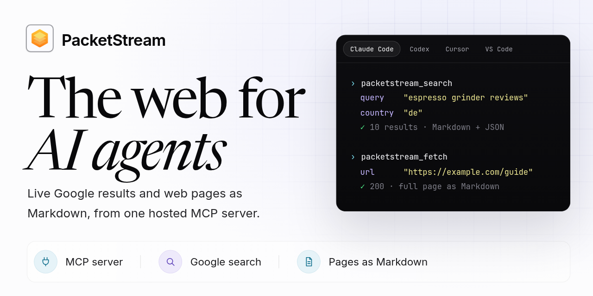

# PacketStream MCP server: live web search and web pages as Markdown for AI agents

PacketStream runs a hosted [Model Context Protocol](https://modelcontextprotocol.io) (MCP) server that gives AI agents and LLM apps two web tools. `packetstream_search` runs a live search on the world's most-used search engine and returns the results as Markdown and JSON. `packetstream_fetch` fetches a web page through PacketStream's residential network and returns the page itself as Markdown, not a summary. Connect it to Claude Code, Codex, Cursor, Gemini CLI, VS Code, Claude Desktop, Cline or any other MCP client that supports remote servers. Each successful call costs $0.0025 ($2.50 per 1,000) from a prepaid balance, with no subscription; see [Pricing](#pricing).

This repository holds the plugin and extension files for Claude Code, Codex, Cursor and Gemini CLI. The server runs at PacketStream, so you host nothing. Install the plugin for your client, or point any MCP client at the server URL.

Full documentation: <https://packetstream.io/docs/mcp/>

## Tools: web search and page fetching

| Tool | What it does |
|---|---|
| `packetstream_search` | Runs a live web search and returns the results as Markdown, with the JSON response as structured content. You can set the country, language, location, device, page and time range. Result types: `search`, `news`, `shopping`, `places`, `autocomplete`, `scholar` and `ai_mode`. |
| `packetstream_fetch` | Reads one public `http` or `https` page and returns it as Markdown, not a summary, with the final URL, HTTP status and title. The request goes through PacketStream's residential network. |

Both tools only read. Apart from the charge for each successful call, they change nothing on your computer or in your PacketStream account.

Good to know about `packetstream_fetch`:

- It reads static HTML only. A page that needs JavaScript returns an error.
- It returns up to 40,000 characters by default. For a longer page, the agent calls it again from the next character.
- It does not read `robots.txt`. You decide which sites your agent reads, and you need any permission the law, a contract or the site operator requires. See [section 7 of our Terms of Service](https://packetstream.io/terms-of-service/#acceptable-use).
- It marks page text as untrusted, so the agent treats it as data and not as instructions.

The [MCP reference](https://packetstream.io/docs/mcp/reference/) lists every argument and result format. The same API key also works with the REST [Search API](https://packetstream.io/docs/search-api/) and [Fetch API](https://packetstream.io/docs/fetch-api/) if you want to call them from your own code.

## Server URLs

There are two URLs. Both serve the same tools at the same price. Use your client's Streamable HTTP transport.

| URL | How you connect |
|---|---|
| `https://api.packetstream.io/v1/mcp/oauth` | **Sign in** with your PacketStream account. Your client opens a PacketStream page in your browser, and you select **Allow**. No key goes in a config file. |
| `https://api.packetstream.io/v1/mcp` | **API key**, sent as `Authorization: Bearer YOUR_API_KEY`. For clients that let you set a header. |

The plugins in this repository use the sign-in URL.

## Before you begin

1. [Sign up](https://app.packetstream.io/signup?account=buy&next=mcp) and add funds to your balance.
2. If your client uses an API key, create one on the [MCP page of the dashboard](https://app.packetstream.io/dashboard/mcp). The key is shown once, so copy it when it appears.

## Install the plugin or connect your client

### Claude Code

```bash
claude plugin marketplace add packetstream/packetstream-mcp
claude plugin install packetstream@packetstream
```

On Claude Code 2.1.275 or later, you can do both in one step inside Claude Code:

```text
/plugin install packetstream --marketplace packetstream/packetstream-mcp
```

Then run `/mcp`, select `packetstream`, and sign in.

### Codex

```bash
codex plugin marketplace add packetstream/packetstream-mcp
codex plugin add packetstream@packetstream
codex mcp login packetstream
```

The last command opens the sign-in page in your browser.

### Cursor

If PacketStream is listed in the Cursor Marketplace, install it there and sign in when Cursor asks. To set it up by hand, add this to `~/.cursor/mcp.json`:

```json
{
  "mcpServers": {
    "packetstream": {
      "url": "https://api.packetstream.io/v1/mcp/oauth"
    }
  }
}
```

### Gemini CLI

```bash
gemini extensions install https://github.com/packetstream/packetstream-mcp
```

Then start Gemini CLI and run `/mcp auth packetstream` to sign in.

### VS Code

Add this to `.vscode/mcp.json` in a workspace, or run **MCP: Open User Configuration** to add it for every workspace. VS Code asks for your API key once and stores it securely:

```json
{
  "inputs": [
    {
      "type": "promptString",
      "id": "packetstream-api-key",
      "description": "PacketStream API key",
      "password": true
    }
  ],
  "servers": {
    "packetstream": {
      "type": "http",
      "url": "https://api.packetstream.io/v1/mcp",
      "headers": { "Authorization": "Bearer ${input:packetstream-api-key}" }
    }
  }
}
```

### Claude and Claude Desktop

Add PacketStream as a custom connector. It signs in with your PacketStream account, so you need no key:

1. In Claude, open **Customize > Connectors**, select **+ Add**, then **Add custom connector**.
2. Name it `PacketStream` and enter `https://api.packetstream.io/v1/mcp/oauth` as the server URL.
3. Claude opens PacketStream in your browser. Log in and select **Allow**.
4. In a chat, turn PacketStream on with the **+** button, under **Connectors**.

On Team and Enterprise plans, an owner adds the connector first; see [Claude custom connectors](https://packetstream.io/docs/mcp/clients/#claude-connectors). The connector belongs to your Claude account, so Claude Desktop can use it too. To use an API key in Claude Desktop instead, follow the [Claude Desktop setup](https://packetstream.io/docs/mcp/clients/#claude-desktop).

### Cline

Cline uses SSE unless you set the transport, so add `"type": "streamableHttp"` to the server in its MCP settings:

```json
{
  "mcpServers": {
    "packetstream": {
      "type": "streamableHttp",
      "url": "https://api.packetstream.io/v1/mcp",
      "headers": { "Authorization": "Bearer YOUR_API_KEY" }
    }
  }
}
```

### Other MCP clients

Any client that supports remote Streamable HTTP servers can connect. Send your API key in the `Authorization` header to `https://api.packetstream.io/v1/mcp`, or use `https://api.packetstream.io/v1/mcp/oauth` if the client supports MCP sign-in (OAuth), as ChatGPT does. We have not tested ChatGPT. If the client runs local (stdio) servers only, use the [`mcp-remote` bridge](https://packetstream.io/docs/mcp/clients/#claude-desktop). [Client setup](https://packetstream.io/docs/mcp/clients/) has the configuration for each client and a troubleshooting guide.

### What we have tested

We tested sign-in end to end with a [Claude custom connector](https://packetstream.io/docs/mcp/clients/#claude-connectors). We tested the API-key setup with Claude Code, Codex CLI and the `mcp-remote` bridge. We have not tested sign-in in Claude Code, Codex, Cursor or Gemini CLI, or the VS Code and Cline setups; those steps follow each client's documentation. If sign-in fails in your client, use its [API-key setup](https://packetstream.io/docs/mcp/clients/).

## Pricing

- Each successful call costs $0.0025 ($2.50 per 1,000), for both searches and fetches. It comes from your prepaid PacketStream balance.
- Failed calls are free, apart from one rare case described under [billing](https://packetstream.io/docs/search-api/errors-limits/#billing). A call without a valid key or sign-in is never billed.
- Connecting and listing the tools are free.
- There is no free tier and no subscription. You add funds first, with a $50 minimum purchase. Purchased balance does not expire.
- An agent can call these tools many times in one task. Check your client's tool-approval settings to control spend.

Limits: all calls with one key share a limit of 20 per second, with bursts of 200. Each signed-in app has its own limit of the same size.

## Privacy

- PacketStream does not store your search queries, the search results, the URLs you fetch or the page content. For each call, we record its request ID and time, the key or connected app, the type of request, the outcome, the provider that handled it, the number of attempts, how long it took and the charge. The dashboard shows your recent requests and daily usage.
- To answer a search, we send your query and its options to third-party search data providers from PacketStream's own account. We do not send them your account identity, API key or IP address.
- Fetches go through the PacketStream residential network. A device on that network can read the content of a page only if the page uses unencrypted `http`.
- An app that signs in never sees your password, API key, payment details or proxy traffic. It can use only the MCP tools. To disconnect an app, use the [MCP page of the dashboard](https://app.packetstream.io/dashboard/mcp). Disconnecting inside an app deletes the app's copy of the sign-in. Apps that support token revocation also end it with us; otherwise it stays valid until it goes unused for 30 days, or until you disconnect it on the dashboard.

Read the full [Privacy Policy](https://packetstream.io/privacy-policy/) and [Terms of Service](https://packetstream.io/terms-of-service/).

## Support

- Email: [help@packetstream.io](mailto:help@packetstream.io)
- Contact form: <https://packetstream.io/contact-us/>
- Troubleshooting: <https://packetstream.io/docs/mcp/clients/#troubleshooting>

## License

The files in this repository are licensed under the [Apache License 2.0](LICENSE). "PacketStream" and the PacketStream logo are trademarks of PacketStream Inc.; the license does not grant permission to use them. See [NOTICE](NOTICE).
